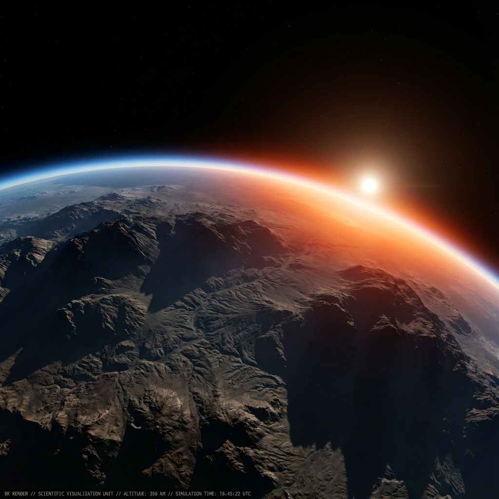

# WebGPU Planetary World

[](https://deepwiki.com/estebanrfp/webgpu-planetary-world)



**A serverless, planet-scale 3-D world in native WebGPU — and a real-world showcase of [GenosDB](https://github.com/estebanrfp/gdb).**

A planetary 3-D world you explore as an avatar: a cube-sphere planet divided
into a parcel **grid**, with procedural terrain, weather, vegetation, real-time
multiplayer presence, and land/assets you can own and trade on-chain.

It is built to **demonstrate what GenosDB can do** in a demanding, real product:
a single distributed database drives the entire live state of a 3-D world —
**peer-to-peer, real-time, offline-capable, reactive and secure — with no
backend server.**

**▶ [Walk around it in your browser](https://estebanrfp.github.io/webgpu-planetary-world/)** · runs
entirely in the browser, no install and no account. Needs a WebGPU browser with
the experimental HTML-in-Canvas flag (see [Requirements](#requirements)).

---

## Why this exists — GenosDB in a real product

Most database demos are to-do lists. This world puts GenosDB under real load
and shows the patterns that make it powerful:

| GenosDB capability | How the world uses it |
|---|---|
| **P2P real-time (GenosRTC)** | Live multiplayer presence — other players appear as animated avatars at the right position/altitude/animation, synced ~12 Hz over WebRTC. **No game server.** |
| **Reactive reads (`db.map`)** | The 3-D world's land map *and* the marketplace subscribe to the same DB with `db.map(query, cb)`; the UI updates live as data changes. |
| **One DB, many consumers** | A single `ovgrid-world` instance serves world state, land, assets, listings, offers and presence. The 3-D client and the marketplace read it the same way. |
| **On-chain mirror (cache over a blockchain)** | Polygon is the source of truth for ownership; a sync layer mirrors it into GenosDB so the world reads **fast, offline and in real time** instead of hitting the chain. |
| **Decentralized identity + RBAC (Security Manager)** | Sign in with WebAuthn biometrics or a BIP39 mnemonic; operations are signed and access-controlled by GenosDB's Security Manager. |
| **Serverless by design** | WebRTC transport + Nostr signaling — there is no central backend to run. |

> The point GenosDB makes here: **the read layer never changes** — whether a
> parcel was claimed locally or minted on-chain, the world reads it the same
> reactive way. GenosDB is the abstraction.

**Full map: [docs/GENOSDB.md](docs/GENOSDB.md)** — how the world uses GenosDB
across presence, world state and the on-chain mirror, with pointers to the code.

## Features

- **Planetary WebGPU renderer** — precomputed atmospheric scattering, adaptive
  LOD terrain (cube-to-sphere on the GPU), deep-sea ocean, volumetric clouds.
- **Autonomous weather & day/night** — seasonal, localized weather and sky that
  evolve on their own, with a Stardew-style calendar.
- **100% procedural world** — terrain, vegetation, palms, rocks and clouds are
  generated on the GPU. No third-party 3-D models are shipped.
- **Avatars & NPCs** — rigged voxel avatars with Mixamo-baked animations
  (walk/run/idle/jump/fly/swim); NPCs populate each parcel you visit.
- **Real-time multiplayer** — remote players as animated avatars over P2P.
- **Land & marketplace** — claim parcels, mint ERC-1155 assets, trade — mirrored
  into GenosDB for instant, reactive reads.
- **In-world HTML UI** — panels, nameplates and tooltips rasterized into the
  WebGPU canvas (see Requirements).
- **Floating-origin precision** — Float64 CPU math for rock-solid geometry at
  planetary scale.

## Requirements

- A **WebGPU-capable browser** (Chrome/Edge 113+, Safari 18+).
- The experimental **HTML-in-Canvas** feature, used for the in-world UI
  (nameplates, panels, tooltips). Enable
  `chrome://flags/#enable-experimental-web-platform-features`.

A boot gate detects both and shows instructions if either is missing.

## Quick start

```bash
pnpm install          # install dependencies

pnpm dev              # dev server (live-server) at http://localhost:3000
# or
bun run build && bun run preview   # production bundle, served at http://localhost:3000
```

Exploring, P2P presence and reading the world need **no account and no keys**.
First-time visitors land on a curated island. Minting land/assets needs a
Pinata (IPFS) key and a wallet — see [`.env.example`](.env.example).

**Shareable positions.** As you move, the address bar keeps a `?p=` deep-link to
your exact spot and camera (position, facing, zoom and parcel). Copy the URL to
send someone straight to that view — e.g.
`estebanrfp.github.io/webgpu-planetary-world/?p=4.66,-5.19,-1.44,-0.94,0.11,0.5,0,70,54`.

## Controls

| Keys | Action |
|---|---|
| `W A S D` | Move · `Q`/`C` up·down (fly) · `Shift` boost |
| 🖱️ | Orbit camera · scroll to zoom |
| `H` | Toggle help/HUD · `G` Debug panel |
| `X` | Sit · `E` enter/exit flight |
| Click the calendar widget | Open the in-world calendar |

## Architecture

The world follows one rule, end to end:

```
CPU = decides WHAT EXISTS (logic, state, precise Float64 coordinates, GenosDB)
GPU = decides HOW IT LOOKS (rendering, shading, effects)
```

**Data layer.** A single GenosDB instance (`ovgrid-world`, created with
`{ rtc: true, sm }`) holds the live state of the world. The 3-D client and the
marketplace both read it reactively via `db.map`; presence flows P2P over
GenosRTC; ownership is mirrored from Polygon.

**Precision (Floating Origin).** The shader assumes the camera at the origin;
all world positions are computed in Float64 on the CPU and passed to the GPU as
small camera-relative Float32 offsets — stable up to LOD 22 at planetary scale.
This is the technique that makes a full-size planet renderable without jitter —
the full post-mortem is in [docs/floating-origin-guide.md](docs/floating-origin-guide.md).

**Terrain.** A dynamic quadtree on the CPU drives per-quad LOD on a cube-sphere;
a hybrid two-stage culling system (horizon culling on the CPU quadtree, then
fine-grained instance culling in a GPU compute shader) keeps only what the camera
can actually see. See [docs/terrain-mesh.md](docs/terrain-mesh.md) and
[docs/culling-system.md](docs/culling-system.md).

**Atmosphere & sky.** Precomputed scattering (Bruneton): transmittance, scattering
and irradiance LUTs. A triple-layer cloud system bakes its fractal noise once into
a texture instead of per-pixel per-frame, and weather (rain, snow, storm) rides a
world-anchored particle treadmill. See [docs/clouds-performance.md](docs/clouds-performance.md)
and [docs/rain-system.md](docs/rain-system.md).

> **Planetary rendering research.** The five docs linked above — floating origin,
> procedural terrain, culling, clouds and weather — are the technical core of how
> this world renders a real-scale planet in the browser. They're grouped again
> under *Documentation → Planetary rendering* below.

## Documentation

**AI-generated wiki** — ask questions about the codebase in natural language

- [**deepwiki.com/estebanrfp/webgpu-planetary-world**](https://deepwiki.com/estebanrfp/webgpu-planetary-world) — DeepWiki auto-indexes this repo into a conversational wiki (architecture diagrams, file walkthroughs, "Ask" chat). Great as an entry point; the hand-written docs below are the authoritative reference.

**GenosDB & data layer** — the reason this project exists

- [docs/GENOSDB.md](docs/GENOSDB.md) — **how the world uses GenosDB (overview)**
- [lib/network/README.md](lib/network/README.md) — **P2P presence & remote avatars (GenosDB / GenosRTC)**
- [lib/marketplace/docs/GENOSDB_INTEGRATION.md](lib/marketplace/docs/GENOSDB_INTEGRATION.md) — **marketplace ↔ GenosDB**
- [docs/VISION.md](docs/VISION.md) — the vision behind the project

**Planetary rendering** — the WebGPU research behind a real-scale world

- [docs/floating-origin-guide.md](docs/floating-origin-guide.md) — **Floating Origin**: Float64 CPU → camera-relative Float32 GPU, jitter-free up to LOD 22
- [docs/terrain-mesh.md](docs/terrain-mesh.md) — procedural planetary terrain (dynamic quadtree + LOD on a cube-sphere)
- [docs/culling-system.md](docs/culling-system.md) — hybrid two-stage culling (CPU horizon + GPU compute instance culling)
- [docs/clouds-performance.md](docs/clouds-performance.md) — triple-layer clouds via GPU texture baking
- [docs/rain-system.md](docs/rain-system.md) — weather pipeline (rain / snow / storm) on a world-anchored treadmill

**Systems & gameplay**

- [docs/IN_WORLD_UI.md](docs/IN_WORLD_UI.md) — HTML-in-Canvas in-world UI
- [docs/GPU_PHYSICS_GRID.md](docs/GPU_PHYSICS_GRID.md) — GPU physics / collision
- [docs/NAVIGATION-SYSTEM.md](docs/NAVIGATION-SYSTEM.md) — camera & movement
- [docs/WEATHER_SYSTEM_PLAN.md](docs/WEATHER_SYSTEM_PLAN.md) — autonomous weather + calendar (design)
- [docs/AUTH_AND_AVATARS.md](docs/AUTH_AND_AVATARS.md) — identity & avatars
- [docs/MARKETPLACE.md](docs/MARKETPLACE.md) — on-chain land + ERC-1155 assets

**Configuration reference** — tune the world (every parameter in `lib/config/`)

- [docs/configuration/README.md](docs/configuration/README.md) — **index + conventions** (units, how a config reaches the engine)
- [terrain](docs/configuration/terrain.md) · [sky & atmosphere](docs/configuration/sky-atmosphere.md) · [ocean](docs/configuration/ocean.md) · [lighting & shadows](docs/configuration/lighting-shadows.md) · [weather](docs/configuration/weather.md) · [vegetation](docs/configuration/vegetation.md)
- [world & planet](docs/configuration/world.md) · [player](docs/configuration/player.md) · [interface](docs/configuration/interface.md) · [performance](docs/configuration/performance.md)

**Legal**

- [THIRD_PARTY_NOTICES.md](THIRD_PARTY_NOTICES.md) — third-party licenses

## License

MIT License — see [LICENSE.md](LICENSE.md).

## Author

Esteban Fuster Pozzi (@estebanrfp) — Full Stack JavaScript Developer
