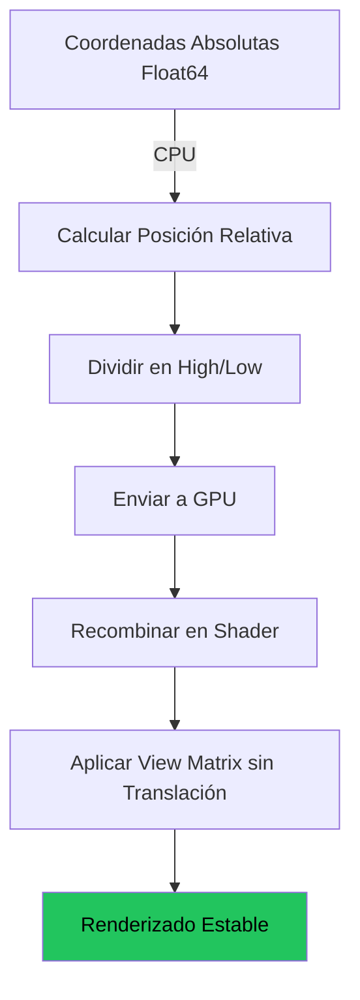

# Post-Mortem: IMPLEMENTACIÓN EXITOSA
> [!TIP]
> **ESTADO: Realizado con éxito**. El sistema de **Floating Origin** está implementado al 100% en la GPU, manejando todos los niveles de LOD (0-22) sin necesidad de fallbacks en la CPU, garantizando una estabilidad milimétrica y un rendimiento masivo.

# 🌍 Guía Técnica: Vibraciones en Mundos Grandes

## Solución de Precisión de Punto Flotante para Renderizado Planetario

> **Resumen:** Este documento analiza el problema crítico de las vibraciones geométricas *(jitter)* en mundos de gran escala y presenta la técnica **Floating Origin** como solución arquitectónica definitiva.

---

## 📋 Tabla de Contenidos

1. [Introducción: El Desafío de la Escala](#1-introducción-el-desafío-de-la-escala)
2. [Diagnóstico del Problema](#2-diagnóstico-del-problema)
3. [Análisis Técnico: Limitaciones de Float32](#3-análisis-técnico-limitaciones-de-float32)
4. [Solución: Técnica Floating Origin](#4-solución-técnica-floating-origin)
5. [Implementación](#5-implementación)
6. [Arquitectura CPU vs GPU](#6-arquitectura-cpu-vs-gpu)
7. [Casos Prácticos](#7-casos-prácticos)
8. [Deuda Técnica Pendiente](#8-deuda-técnica-pendiente)
9. [Conclusiones](#9-conclusiones)

---

## 1. Introducción: El Desafío de la Escala

El objetivo estratégico de crear mundos de escala sin precedentes enfrenta una barrera técnica fundamental. Al escalar el radio planetario desde valores modestos (4,000 metros) a valores de magnitud planetaria real, aparecen **artefactos visuales severos** a nivel del suelo.

> [!WARNING]
> A la escala requerida para una vista a nivel de personaje, la geometría del mundo se vuelve inestable, renderizando el entorno como "basura" inutilizable.

### Síntomas Observados

| Síntoma | Descripción |
|---------|-------------|
| **Temblor geométrico** | La geometría del terreno vibra constantemente |
| **Parpadeo de triángulos** | Los triángulos "saltan" entre posiciones |
| **Inestabilidad estática** | Ocurre incluso con cámara completamente inmóvil |
| **Colapso visual** | Triángulos se colapsan o invierten impredeciblemente |

---

## 2. Diagnóstico del Problema

### Identificación de los Artefactos Visuales

El diagnóstico riguroso de los síntomas visuales es fundamental. Los artefactos se manifiestan más severamente cuando la cámara está posicionada cerca de la superficie del planeta.

**Síntomas principales:**

- ✖ Geometría del suelo con "temblor y parpadeo" pronunciado
- ✖ En modo wireframe: los triángulos se agitan descontroladamente
- ✖ Inestabilidad presente incluso con cámara estática

> [!IMPORTANT]
> Estos síntomas confirman que los artefactos **no** están relacionados con sistemas de alto nivel como texturizado. El problema se origina en un nivel más fundamental: cómo los datos de posición de vértices se representan numéricamente.

---

## 3. Análisis Técnico: Limitaciones de Float32

### La Raíz del Problema

La inestabilidad observada es consecuencia directa de la **precisión finita** del número de punto flotante de 32 bits (`float32`). Esta limitación no es un bug en el código, sino una realidad matemática fundamental.

### Anatomía de un Float32

```
┌─────┬──────────┬─────────────────────────┐
│Sign │ Exponent │        Mantissa         │
│1 bit│  8 bits  │        23 bits          │
└─────┴──────────┴─────────────────────────┘
```

**Consecuencia:** Solo 6-7 dígitos decimales de precisión disponibles.

### Pérdida de Precisión a Escala

| Escenario | Posición (X) | Operación | Resultado Float32 | Análisis |
|-----------|-------------|-----------|-------------------|----------|
| **Cerca del origen** | `10.0` | Sumar 0.001 (1mm) | `~10.0010004` | ✅ Precisión suficiente |
| **Lejos del origen** | `100,000.0` | Sumar 0.001 (1mm) | `100,000.0` | ❌ El milímetro se **descarta** |

### ¿Por Qué Ocurre el Jitter?

```
Coordenadas grandes → GPU sin precisión para diferencias pequeñas
                    → Vértices "saltan" al valor representable más cercano
                    → Vértices adyacentes redondean a la misma coordenada
                    → Triángulos colapsan o se invierten
                    → JITTER VISUAL
```

> [!CAUTION]
> Aunque JavaScript usa floats de 64 bits, el pipeline GPU opera con floats de 32 bits. Usar doubles en todas partes es una "solución con cinta adhesiva" que no resuelve el problema arquitectónico fundamental.

---

## 4. Solución: Técnica Floating Origin

### Cambio de Paradigma

La técnica **Floating Origin** no es una corrección menor, sino un **cambio fundamental** en cómo gestionamos las coordenadas del mundo para renderizado.

### Principio Fundamental

> **Los cálculos de punto flotante son altamente precisos cerca de `0.0`**

Por lo tanto, arquitecturamos el pipeline de renderizado para asegurar que **la cámara siempre esté en el origen `(0,0,0)`**.

### Concepto Visual

```
┌─────────────────────────────────────────────────────┐
│           ENFOQUE TRADICIONAL (❌)                  │
│                                                     │
│    Mundo Estático          Cámara Móvil             │
│    ┌──────────┐            ────────────▶            │
│    │  (0,0,0) │                📷                   │
│    └──────────┘         (100000, 50000, 0)          │
│                                                     │
│    Resultado: Coordenadas gigantes → JITTER         │
└─────────────────────────────────────────────────────┘

┌─────────────────────────────────────────────────────┐
│           FLOATING ORIGIN (✅)                      │
│                                                     │
│    Cámara Estática         Mundo Móvil              │
│         📷                 ◀────────────            │
│      (0,0,0)              Δ = offset inverso        │
│                                                     │
│    Resultado: Coordenadas pequeñas → ESTABLE        │
└─────────────────────────────────────────────────────┘
```

### Beneficios Clave

| Beneficio | Descripción |
|-----------|-------------|
| **Precisión máxima** | Toda la geometría usa números pequeños y precisos |
| **Escala infinita** | Sin límite de distancia desde el origen absoluto |
| **Sin artefactos** | Elimina completamente el jitter por precisión |
| **Estándar industrial** | Técnica probada en engines profesionales |

---

## 5. Implementación

### Cambios Arquitectónicos Requeridos

#### 5.1 Generación de Mesh Relativa

Los workers de generación de terreno deben aceptar un parámetro de **origen** (posición actual de la cámara).

```javascript
// CPU - Generación relativa al origen
const chunkWorldPos = calculateChunkPosition(chunkId);
const cameraPos = camera.getWorldPosition();

// Posición relativa para la GPU
const relativePos = subtractVec3(chunkWorldPos, cameraPos);
```

#### 5.2 Transformación Manual de Vértices

```javascript
// Transformar a coordenadas absolutas temporalmente
const absolutePos = localPos + chunkWorldPos;

// Inmediatamente convertir a espacio relativo a cámara
const cameraRelativePos = absolutePos - cameraOrigin;

// ✅ Valores pequeños y precisos para la GPU
```

#### 5.3 División High/Low para Precisión Extrema

Para mundos verdaderamente gigantes, dividir coordenadas en componentes:

```javascript
// CPU - División de coordenadas Float64
const splitPosition = (worldPos, cameraPos) => {
  const relative = worldPos - cameraPos;  // Float64
  
  // Dividir en high (entero) y low (fracción)
  const high = Math.floor(relative);
  const low = relative - high;
  
  return { posHigh: high, posLow: low };
};
```

#### 5.4 Shader WGSL Modificado

```wgsl
struct VertexInput {
    @location(0) posHigh: vec3<f32>,
    @location(1) posLow: vec3<f32>,
}

@vertex
fn vs_main(in: VertexInput) -> VertexOutput {
    // Recombinar con precisión máxima
    let localPos = in.posHigh + in.posLow;
    
    // View matrix SIN translación (cámara en origen)
    let viewNoTranslation = mat4x4<f32>(
        view[0], view[1], view[2],
        vec4<f32>(0.0, 0.0, 0.0, 1.0)
    );
    
    // ✅ Transformación estable
    out.position = projection * viewNoTranslation * vec4<f32>(localPos, 1.0);
    return out;
}
```

#### 5.5 Actualización Dinámica de Chunks

```javascript
// Cada frame: recalcular offset de cada chunk
updateChunkPositions() {
  for (const chunk of visibleChunks) {
    const delta = subtractVec3(chunk.generatedOrigin, camera.position);
    chunk.renderOffset = delta;  // Para enviar a GPU
  }
}
```

---

## 6. Arquitectura CPU vs GPU

### Regla Fundamental

| CPU | GPU |
|-----|-----|
| **Decide QUÉ existe** | **Decide CÓMO se ve** |

### División de Responsabilidades

#### 🖥️ CPU (JavaScript)

| Tarea | Descripción |
|-------|-------------|
| Estado global del mundo | Coordenadas absolutas (Float64) |
| Decisiones de LOD | Qué chunks se dibujan |
| Cálculo de offsets | high/low para cada chunk |
| Física de cuerpos rígidos | Simulación de gameplay |
| Streaming de recursos | Carga de texturas, meshes |
| Networking | Sincronización multijugador |

#### 🎮 GPU (WGSL/WebGPU)

| Tarea | Descripción |
|-------|-------------|
| Renderizado de agua | Ondas, reflexiones, fresnel |
| Texturizado | Sampling, mipmapping, triplanar |
| Terreno shading | Blending de materiales, normales |
| Postprocesado | HDR, bloom, SSAO, fog |
| Partículas | Compute shaders para efectos |

> [!NOTE]
> **¿Por qué GPU?** Es más rápido, aprovecha el paralelismo masivo, y reduce latencia. Mover estos cálculos a CPU rompería el rendimiento.

### Precomputo de Valores Críticos (Float64 → Float32)

Algunos cálculos requieren precisión Float64 pero deben ejecutarse en GPU (Float32). La solución es **precomputar valores críticos en CPU**:

#### Caso Resuelto: Discriminante de Intersección Rayo-Esfera

**Problema Original:**
```wgsl
// ❌ Resta de números grandes en Float32 → pérdida de precisión → JITTER
let ray_center_sq = camera_radius_sq - earth_dot_v * earth_dot_v;
//                   ~40,449,600    -    ~40,449,500
```

**Solución Implementada:**
```javascript
// ✅ CPU (Float64): Precomputa con alta precisión en (lib/config/planetConfig.js)
// Matemáticamente: earth_radius² - camera_radius² = -altitude * (2*R + altitude)
const discriminantBase = -cameraAltitude * (2 * constants.PLANET_RADIUS + cameraAltitude);

// Pasar a GPU como uniform
uniformScratch.set([cameraAltitude, cameraRadius, discriminantBase, env.exposure], 32);
```

```wgsl
// ✅ GPU: Solo suma valores pequeños
let discriminant_base = globals.camera_exposure.z;  // Del CPU
let ground_discriminant = discriminant_base + earth_dot_v * earth_dot_v;
```

| Operación | Antes (Float32) | Ahora |
|-----------|-----------------|-------|
| `R² - camera_radius²` | ~40M - ~40M = pérdida | CPU precomputa con Float64 |
| `+ earth_dot_v²` | GPU | GPU (valores pequeños, preciso) |

---

## 7. Casos Prácticos

### 7.1 Agua Estable en Mundo Gigante

#### ❌ Enfoque Incorrecto (Causa Jitter)

```wgsl
// worldPos.x puede ser ENORME (millones)
let wave = sin(worldPos.x * k + time);
// ⚠️ Pérdida de precisión → ondas inestables
```

#### ✅ Enfoque Correcto (Estable)

```wgsl
// Usar posición local relativa a cámara
let localPos = in.posHigh + in.posLow;  // Valores pequeños
let wave = sin(localPos.x * 0.2 + time) * 0.1;
// ✅ Ondas perfectamente estables
```

### 7.2 Fresnel y Reflexiones

```wgsl
// Cálculos en espacio local
let viewDir = normalize(-localPos);
let fresnel = pow(1.0 - dot(normal, viewDir), 5.0);
let color = mix(waterColor, reflectColor, fresnel);
// ✅ Sin impacto del tamaño del mundo
```

### 7.3 Texturas World-Space

```wgsl
// Para texturas que necesitan coordenadas world-space
// Pasar UV world-space por separado desde CPU
let worldUV = in.worldTexCoord;  // Calculado en CPU con Float64
let albedo = textureSample(terrainTex, sampler, worldUV);
```

---

## 8. Estado Actual y Resoluciones

La arquitectura actual ha resuelto exitosamente los desafíos secundarios originalmente identificados como deuda técnica:

### 8.1 Texture Swimming & Stability (Optimizado ✅)
- **Problema:** Las texturas se "deslizaban" al mover la cámara debido a la precisión de la normal.
- **Solución:** Reconstrucción procedural de la `sphereNormal` directamente en el Shader. Esto garantiza que la normal sea idéntica para todos los bloques independientemente de la CPU, eliminando cualquier deslizamiento.

### 8.2 Terrain Seams (Evolución Analítica ✅)
- **Problema:** Grietas visibles entre chunks de diferente LOD.
- **Solución:** Sincronía Matemática de Altura. El número de octavas de ruido depende de la `distToCamera`, no del LOD del bloque. Como los bloques vecinos comparten la misma distancia en su borde, ambos calculan la misma altura exacta. Los *Skirts* (faldones) ahora son solo un sello de seguridad mínimo (500m).

### 8.3 VRAM & Eficiencia (Optimizado ✅)
- **Logro:** Reducción del **55% en el uso de VRAM** (de 112MB a 51MB).
- **Cómo:** Se eliminó la normal y sphereNormal del buffer de vértices (de 11 a 5 floats por vértice), delegando el cálculo totalmente a la GPU.

---

## 9. Conclusiones

### Lecciones Aprendidas

> [!IMPORTANT]
> Renderizar mundos estables y de gran escala **no es posible** usando un sistema de coordenadas absolutas naive debido a las limitaciones inherentes de precisión de los números de punto flotante de 32 bits.

### La Técnica Floating Origin

✅ Es un patrón arquitectónico **fundacional**  
✅ Re-centra el mundo alrededor de la cámara cada frame  
✅ Garantiza que todos los cálculos GPU usen números pequeños y precisos  
✅ Delegación total a GPU: Normales y ruido sincronizados analíticamente
✅ Permite escalar a tamaños planetarios **sin artefactos visuales ni sobrecarga de VRAM**

### Diagrama de Flujo Final



### Próximos Pasos (Optimización Continua)

1. ⚡ **Async Texture Loading:** Mejorar la carga de texturas KTX2 durante el vuelo rápido.
2. ⚡ **Atmosphere Tuning:** Refinar los LUTs para biomas extremos.
3. ⚡ **Shadow Distances:** Ajustar el cascade de sombras para mayor detalle a ras de suelo.

---

## 📚 Referencias

- SimonDev: Floating Origins for Large 3D Worlds
- WebGPU Specification: Precision and Numerical Limits
- Game Engine Architecture: Coordinate Systems for Open Worlds

---

*Documento generado para el proyecto WebGPU Planetary World - WebGPU Atmospheric Scattering*

---

## Related — Planetary rendering

Part of this project's planetary-rendering research set:

- [terrain-mesh.md](terrain-mesh.md) — procedural planetary terrain (quadtree + LOD)
- [culling-system.md](culling-system.md) — hybrid CPU + GPU culling
- [clouds-performance.md](clouds-performance.md) — GPU-baked triple-layer clouds
- [rain-system.md](rain-system.md) — weather pipeline (rain / snow / storm)

← back to the [README](../README.md#documentation)
